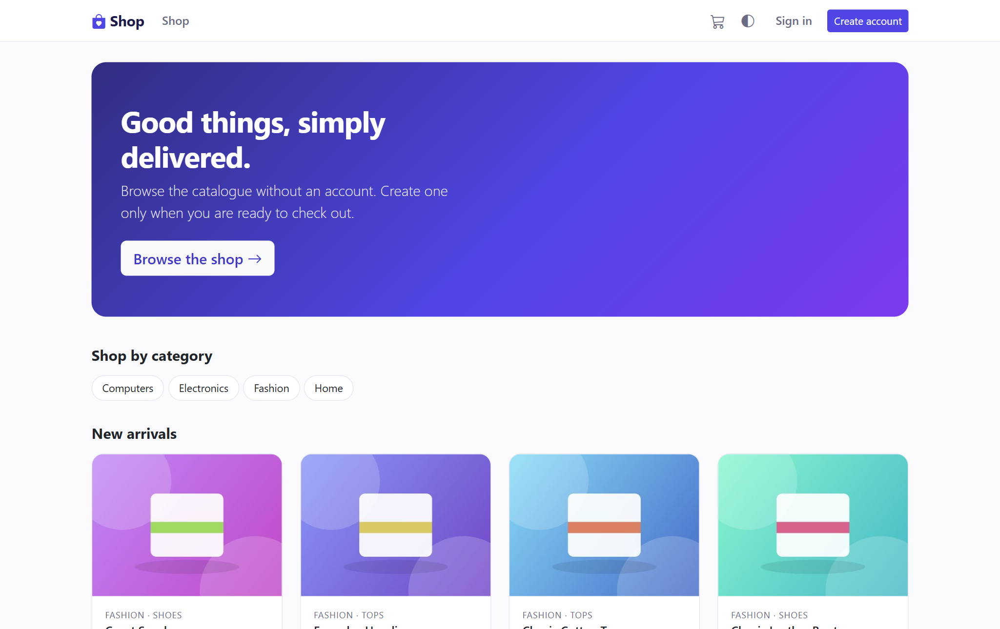
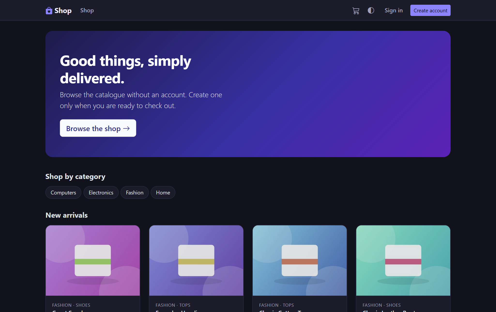
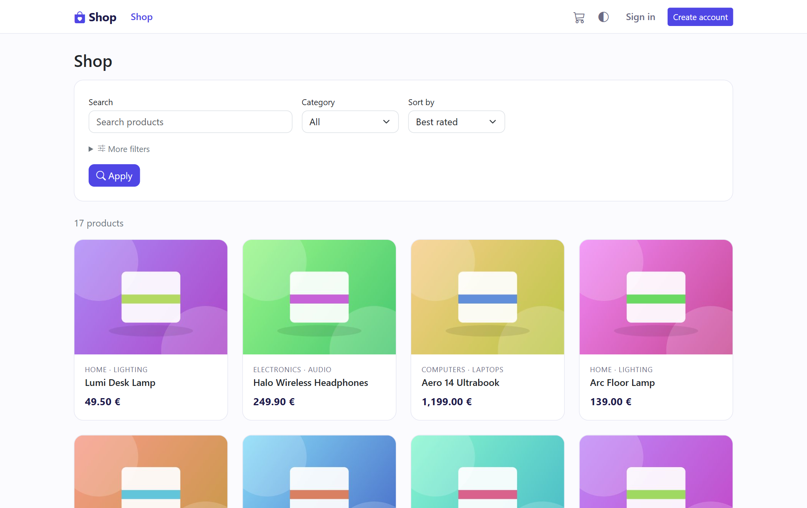
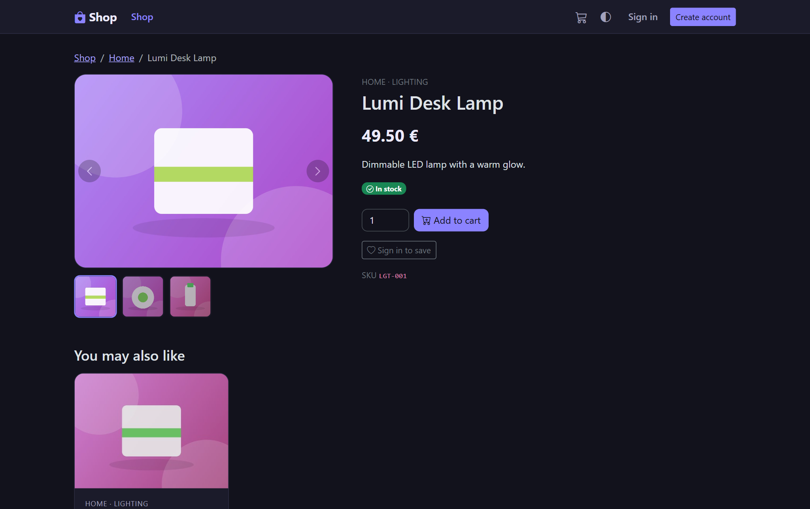
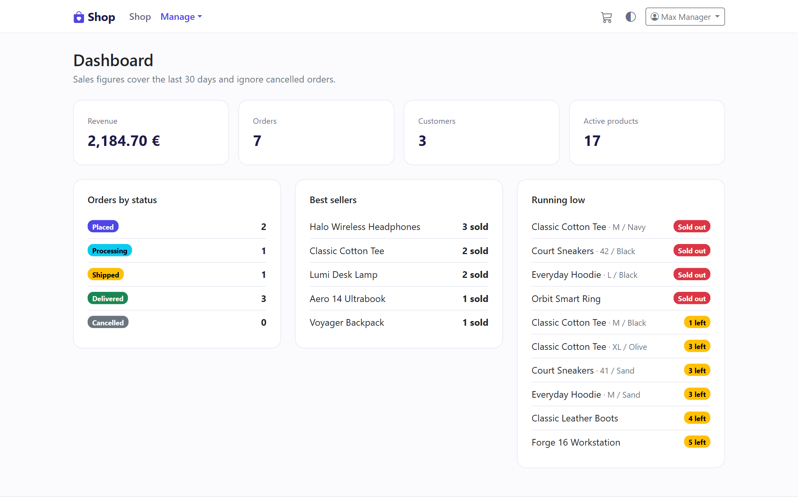
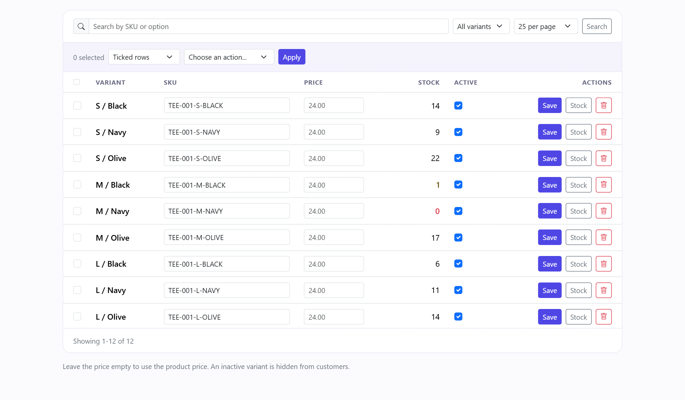
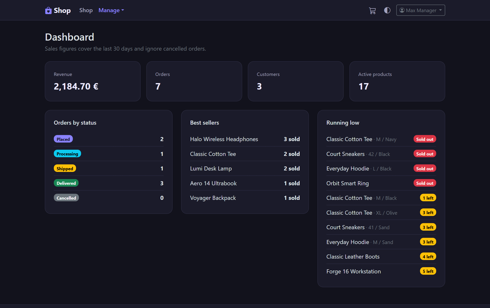
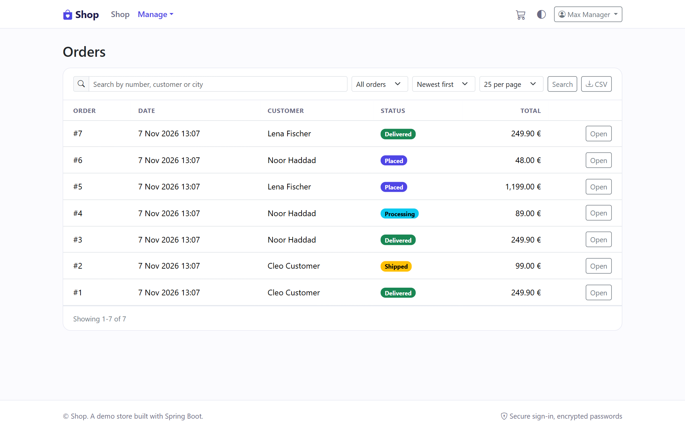
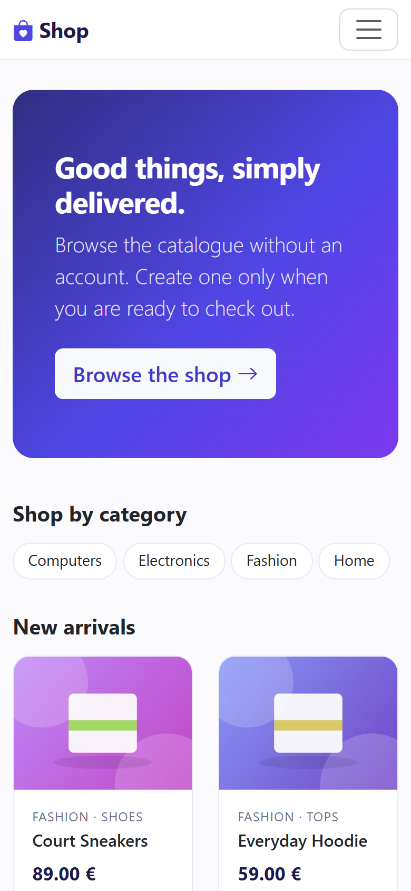
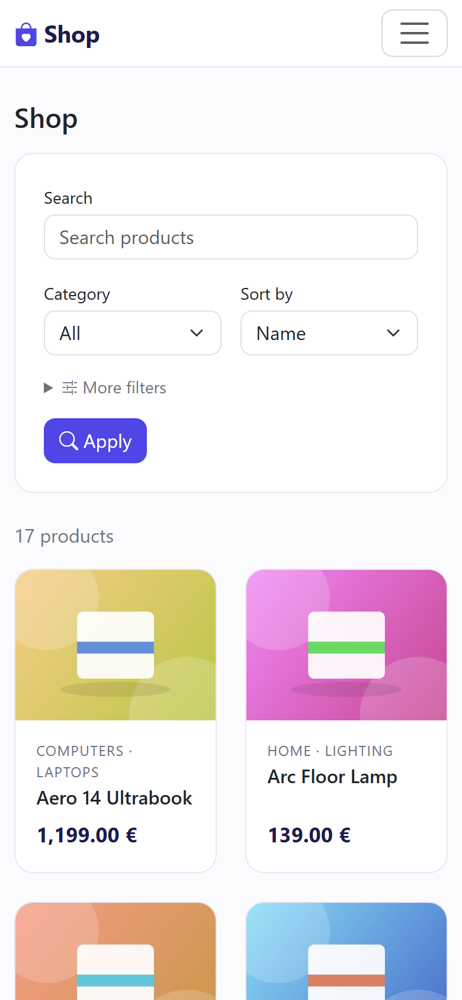

# Shop

An online store built with Spring Boot: a public storefront, customer accounts, a back office for
managers and admins, and a REST API with token authentication.

It started as a university exercise and was rebuilt in place, with its history kept, into a tested,
containerised application: layered packages, Flyway-owned schema, role-based security with two-factor
sign-in, audit trail, PDF invoices, email, and CI that scans for vulnerabilities and secrets.

## Screenshots

Taken from the `demo` profile with its sample data.

| Storefront | Storefront (dark) |
| --- | --- |
|  |  |
|  |  |

| Dashboard | Variants workspace |
| --- | --- |
|  |  |
|  |  |

 
## Contents

- [Screenshots](#screenshots)
- [Features](#features)
- [Roles](#roles)
- [Security](#security)
- [Stack](#stack)
- [Run it](#run-it)
- [Configuration](#configuration)
- [Behind Nginx](#behind-nginx)
- [Project layout](#project-layout)
- [Tests and CI](#tests-and-ci)
- [Roadmap](#roadmap)

## Features

### Storefront

- Guests browse, search, filter and sort without an account: category and type, price range (checked
  against what each variant really costs), in-stock only, minimum rating, and sorting by name, price,
  newest or best rated.
- Several pictures per product, shown as a carousel with a primary picture.
- Reviews from verified buyers (one each, editable) and a wishlist for signed-in users.
- Related products: the ones a manager picked, then what other customers bought together, then the rest
  of the subcategory. Hidden products are never shown.
- Light and dark theme. It follows the system setting and can be switched by hand.
- Success, info, warning and error messages appear as toasts at the bottom right.
- SEO basics: descriptions, canonical addresses, Open Graph and Twitter tags, schema.org product data,
  `robots.txt` and `sitemap.xml`. Filtered, sorted and paged lists are marked `noindex`.

### Cart, checkout and orders

- Guests can fill a basket and keep it through sign-in. It is lost when the session ends. Checkout needs
  an account. A signed-in customer's basket is saved and follows them across devices (baskets idle for
  60 days are cleaned up).
- Delivery addresses (`/account/addresses`): save up to ten. Type an address, search, use your current
  location, or drop a pin on an OpenStreetMap map. Every field stays editable. Geocoding goes through the
  server (cached and throttled).
- Optional percentage coupons with an expiry date and a usage limit.
- Stock is taken atomically so two buyers can never oversell. Every change is logged in
  `stock_movements`, and cancelling returns the items.
- Customers see their orders and can cancel while an order is still only placed.
- Orders follow a workflow: placed, processing, shipped, delivered, cancelled.
- PDF invoices: one per order, numbered `INV-2026-000001` onwards without repeats or gaps. Prices include
  VAT, and the seller details and VAT rate are copied in when the invoice is issued, so changing the
  settings never alters one that was already sent. The PDF is attached to the order confirmation email
  and can be downloaded by the customer, managers and the API.

### Products, options and variants

A *product type* (for example Clothing) lists which *options* its products come in (Size, Color).
Options are shared and their values are managed once, so nobody re-enters them per product. Tick the
values a product is sold in and every missing combination becomes a variant with its own SKU, price
override, stock and active flag. A unique key on the combination makes duplicates impossible, even
with two managers working at once.

The variants page (`/manage/products/{id}/variants`) pages, searches and filters on the server, scrolls
with a sticky header and offers bulk actions on ticked rows or on everything a search matches: set or
clear a price, add or remove stock (logged), activate, deactivate and delete (ordered variants are
protected). Missing option values can be added in place. SKUs are suggested from the product name and
options and can be edited.

### Back office (`/manage`)

- Dashboard with revenue, orders by status, best sellers and low-stock alerts. Each product can set its
  own low-stock level.
- Products, categories, subcategories, suppliers, orders, coupons, customers and related products.
- Every list is searched, filtered, sorted and paged in the database. Page sizes are 10, 25, 50 or 100
  and search text is escaped. Tests count SQL statements so a list never costs one query per row.
- CSV exports of orders, products, customers, coupons, stock history and (admins) the audit log. Each
  downloads what the list shows with its current filters. Files open correctly in Excel, text a
  spreadsheet could read as a formula is neutralised, exports over 100,000 rows are refused, and every
  export is written to the audit log because it holds personal data.

### Admin (`/admin`)

- Users: search, change role, enable or disable, unlock, reset someone's two-factor.
- Audit log: every change by a manager or admin.
- Emails: edit the wording of every email (plain text with `{{placeholders}}`, live preview, a test
  email to yourself, one click back to the original). Nothing is executed or rendered as markup, and
  unknown placeholders are refused.
- Settings: shop name, accent colour, footer, support address, seller details and VAT rate.

### Email

Confirmation, password reset, order confirmation (with the invoice), shipping notice, low-stock alerts
for staff and back-in-stock alerts for customers. Links are single-use and stored only as hashes.

- Customers who have an item in their saved basket, or whose wishlist holds its product, get a
  back-in-stock email at most once a week per item, unless they turned it off in their profile.
- A per-address cooldown (`MAIL_COOLDOWN`, default 60s) keeps the sign-up and reset forms from being used
  to flood someone.
- Mail is composed in a short transaction and sent afterwards from a small thread pool (`MAIL_ASYNC`), so a
  slow mail server or PDF render never holds a customer's request or a database connection.
- By default no mail is sent: emails are saved as text files in `mail-outbox/`.

### REST API (`/api`, interactive docs at `/api/docs`)

- Public catalog search, manager-only product changes, and register, log in, refresh and log out with
  short-lived JWT access tokens and rotating refresh tokens.
- `POST /api/orders` places an order from a list of variants, a coupon and either a saved address or a
  typed one. It needs an `Idempotency-Key` header: a retry with the same key and body returns the same
  order (`Idempotent-Replayed: true`) instead of ordering twice, and a different body under the same key
  is refused.
- Customers list, read and cancel their own orders. Managers list, filter and move any order along its
  workflow under `/api/manage/orders`.
- Errors are RFC 9457 problem documents.

## Roles

| Role | Can |
| --- | --- |
| Guest | Browse, search and filter, fill a basket, register, sign in, reset a forgotten password. |
| `CUSTOMER` | Everything above, plus check out, see and cancel own orders, download invoices, keep addresses and a wishlist, review what they bought, manage their profile and two-factor. |
| `MANAGER` | Everything above, plus run the shop in `/manage`: catalog, variants, stock, orders, coupons, customers, exports. Two-factor is required. |
| `ADMIN` | Everything above, plus users, roles, audit log, email wording and shop settings. Two-factor is required. |

Public sign-up can only ever create a `CUSTOMER`. A guest who is not signed in cannot reset a password
until they have an account, and a guest checking out is asked to sign in or register first.

## Security

- Passwords are stored with BCrypt. Five wrong passwords lock an account for 15 minutes.
- The website uses a session cookie (HttpOnly, SameSite=Lax, Secure by default in production) with CSRF
  protection. The API is stateless and uses bearer tokens.
- Website sessions follow the account: disabling it or changing its password ends them, and a role
  change applies immediately.
- Refresh tokens are random, stored only as hashes, valid once (claimed atomically), and reuse of an old
  token signs the account out everywhere. A role change revokes them, and staff cannot get a token
  without having set up two-factor.
- Order status changes, coupon redemption and stock updates are conditional database updates, so
  concurrent requests cannot restock or redeem twice.
- **Two-factor authentication** with any authenticator app (TOTP, RFC 6238). Managers and admins must use
  it, customers may. Secrets are encrypted at rest, a code works only once, wrong codes are rate limited,
  and recovery codes are single-use keyed hashes. "Trust this device" skips the code for 30 days (random
  cookie, stored only as a hash, forgotten when the password changes). The API asks staff for the code
  too (`otp` field).
- **Audit log** (`/admin/audit`): every change by a manager or admin, in the back office and through the
  API, is recorded with who, what, result and IP. The table is append-only. Security changes such as
  turning two-factor on and exports are recorded too.
- Strict Content-Security-Policy (no inline scripts), frame denial and referrer policy.
- Map tiles and address search call OpenStreetMap services, so those two hosts are allowed by the policy.
  Everything else is served locally.
- SQL is parameterised everywhere, search text is escaped, and queries are checked for N+1 behaviour.
- CI runs CodeQL, gitleaks and dependency review. See [SECURITY.md](SECURITY.md).

## Stack

Java 21, Spring Boot 3.5, Spring Security, Spring Data JPA, Flyway, Thymeleaf, Bootstrap 5, Bean
Validation, MapStruct and Lombok. OpenHTMLtoPDF for invoices, ZXing for two-factor QR codes, Caffeine for
caches and Leaflet for the map. H2 for development and tests, MySQL 8.4 for production.

## Run it

```bash
./mvnw spring-boot:run                                   # in-memory H2, nothing to install
./mvnw spring-boot:run -Dspring-boot.run.profiles=demo   # same, with sample products and accounts
./mvnw verify                                            # build and run every test
```

Open <http://localhost:8081>. With the `demo` profile the sample accounts (`admin@demo.shop`,
`manager@demo.shop`, `customer@demo.shop`) get random passwords printed once to the console. The demo
profile also turns staff two-factor off so it is easy to look around; never use it for a real shop.

To create your own first administrator set `ADMIN_EMAIL` and `ADMIN_PASSWORD` before starting.

Everything in containers (app, MySQL and a mail inbox), with sample data:

```bash
export JWT_SECRET=$(openssl rand -base64 48)
docker compose up --build
```

Open <http://localhost:8081> for the shop and <http://localhost:8025> for the mail inbox. Both ports are
bound to localhost only. The sample accounts have random passwords:
`docker compose logs app | grep "Demo account"`.

With MySQL:

```bash
DB_URL=jdbc:mysql://localhost:3306/shop DB_USERNAME=shop DB_PASSWORD=... \
JWT_SECRET=$(openssl rand -base64 48) MAIL_ENABLED=false \
  ./mvnw spring-boot:run -Dspring-boot.run.profiles=mysql
```

With the `mysql` profile `JWT_SECRET` (at least 32 characters) and `MAIL_ENABLED` must be set, and the
session cookie is `Secure` by default. Set `SESSION_COOKIE_SECURE=false` only for plain-HTTP local runs.

The schema is owned by Flyway migrations in `src/main/resources/db/migration`. Hibernate only validates
that the entities match it.

## Configuration

| Variable | Default | Purpose |
| --- | --- | --- |
| `JWT_SECRET` | none | Signs API tokens. At least 32 characters. Required with MySQL. |
| `DB_URL`, `DB_USERNAME`, `DB_PASSWORD` | local MySQL | Database connection (`mysql` profile). |
| `ADMIN_EMAIL`, `ADMIN_PASSWORD` | none | Creates the first administrator. |
| `APP_BASE_URL` | `http://localhost:8081` | Public address used in links, canonical tags and the sitemap. |
| `SESSION_COOKIE_SECURE` | `false` (`true` with MySQL) | Marks the session cookie Secure. |
| `FORWARD_HEADERS` | `none` | Set to `framework` only behind a proxy you control, so the real client address is used. |
| `MFA_STAFF_2FA` | `true` | Require two-factor for managers and admins. |
| `MFA_TOTP_KEY` | derived from `JWT_SECRET` | Key that encrypts stored authenticator secrets. |
| `MAIL_ENABLED` | `false` | `true` sends real mail. With it on, customers must confirm their address before ordering. |
| `MAIL_FROM`, `SMTP_HOST`, `SMTP_PORT`, `SMTP_USERNAME`, `SMTP_PASSWORD`, `SMTP_AUTH`, `SMTP_STARTTLS` | local | Mail server. |
| `MAIL_ASYNC`, `MAIL_COOLDOWN` | `true`, `60s` | Send mail off the request thread, and the per-address cooldown. |
| `IMAGES_DIR` | `./data/images` | Where uploaded product pictures are stored. |
| `GEO_ENABLED`, `GEO_URL`, `GEO_USER_AGENT`, `GEO_TILE_URL` | OpenStreetMap | Address search and map tiles. For production use your own provider or instance, in line with the Nominatim usage policy. |

## Behind Nginx

`deploy/nginx/shop.conf` is a ready-made reverse-proxy configuration. It rate limits what is worth
limiting (password guessing and sign-up at 6 attempts a minute per address, the API token endpoints, API
order placement, and a generous ceiling for everything else) and caches pictures and static files. Limits
apply to POSTs only on the sign-in pages, so opening them is never slowed. Try it with the shop in Docker:

```bash
docker compose -f compose.yaml -f deploy/compose.nginx.yaml up --build     # then open http://localhost:8080
```

In that setup only Nginx is reachable; the app port is not published. Behind your own proxy set
`FORWARD_HEADERS=framework` so the audit log and limits see the visitor's real address (leave it unset
when the app is reachable directly, otherwise anyone could forge it), and keep `SESSION_COOKIE_SECURE` at
its default once HTTPS is in place. CI checks that the configuration is valid.

## Project layout

```
src/main/java/com/marzouki/shop
  catalog/     products, categories, options, variants and their back-office pages
  cart/        session and saved baskets, pricing
  order/       orders, coupons, stock movements, checkout
  invoice/     invoice numbering and PDF rendering
  customer/    customer list and detail for staff
  engagement/  reviews, wishlist, related products, back-in-stock alerts
  address/     address book
  geo/         address search (geocoding)
  dashboard/   manager overview
  export/      CSV exports
  user/        accounts, roles, recovery
  security/    web and API security, JWT, two-factor, session handling
  audit/       append-only audit log
  settings/    shop settings and editable email wording
  mail/        email composition and delivery
  media/       product image processing and storage
  seo/         meta tags, sitemap, robots
  api/         REST controllers and OpenAPI
  common/      shared helpers: list queries, errors, escaping
  setup/       first-admin bootstrap and demo data
deploy/        Nginx configuration and compose overlay
```

## Tests and CI

`./mvnw verify` runs unit, web and integration tests: the security matrix, checkout flow, concurrency
guards, two-factor, invoices, exports, listing query counts and email flows.

On every pull request CI runs the suite on Java 21 and again against MySQL 8.4, CodeQL, gitleaks,
dependency review, a container build with a compose smoke test, and a check of the Nginx configuration.

## Roadmap

Left out on purpose for now: online payments, multiple languages, and GDPR export and delete.

## License

[MIT](LICENSE)
